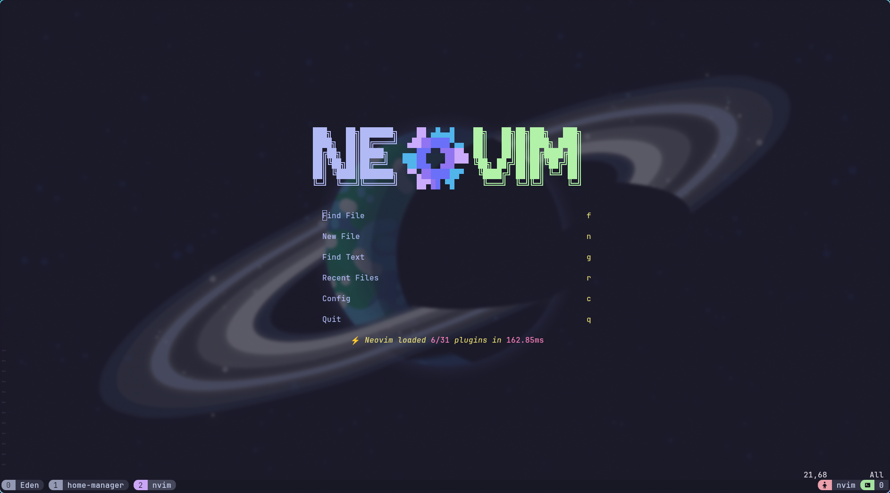
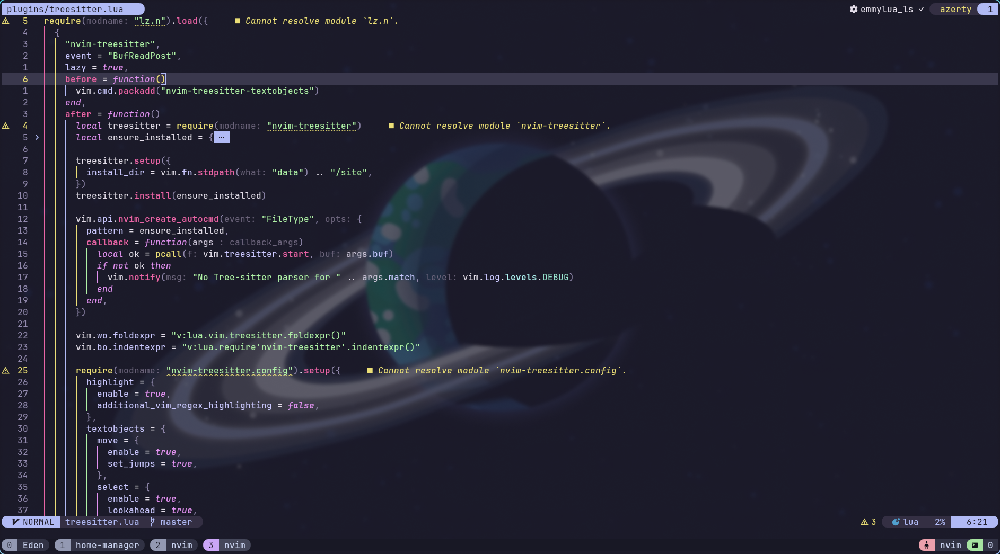

# Neovim Configuration

My Neovim 0.12 configuration, managed with Home Manager.




## Checks

```bash
nix flake check
./scripts/check
./scripts/benchmark
```

CI runs the same checks on pushes and pull requests. A weekly job checks dependencies and upstream projects.

`scripts/check` includes a real C# solution: Roslyn navigation, completion,
diagnostics, rename and code actions; CSharpier formatting; build/run/test commands;
test discovery; and a debugger breakpoint with variable evaluation. It also checks
failing builds and tests. The fixture restores pinned xUnit packages from NuGet,
so the check needs network access. Failed runs retain their logs and fixtures in
the temporary directory printed by the script.
